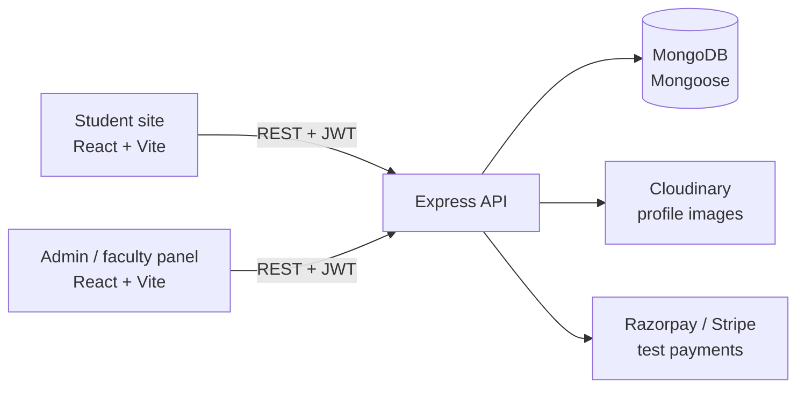

# CampusConnect — book time with faculty, not chase them

A full-stack portal where students find faculty by department, see when they're available, and book an appointment slot online. Faculty manage their own availability and appointments, and an admin panel manages faculty and oversees every booking.

## The problem

Meeting a professor usually means walking to their cabin and hoping they're in, or emailing and waiting days for a reply. Students waste time, faculty get interrupted at random, and nobody can see who is free when.

## What it does

**Students** (`frontend/`)
- Browse faculty by department (Computer Science, AI-ML, Civil Engineering, Architecture, Fashion Design and more).
- See each faculty member's profile and whether they're accepting appointments.
- Pick a date and a 30-minute time slot and book it; view and cancel their appointments.
- Pay online for bookings that need it (Razorpay or Stripe, test mode).
- Manage their own profile, including a photo uploaded to Cloudinary.

**Faculty** (`admin/`, faculty login)
- Dashboard of upcoming appointments.
- Mark appointments completed or cancel them.
- Turn their availability on or off and update their profile.

**Admin** (`admin/`, admin login)
- Add faculty members with photo, department and details.
- See every appointment across the campus and cancel when needed.
- Dashboard with totals for faculty, appointments and students.

## Design decisions and trade-offs

| Decision | Why | Trade-off accepted |
| --- | --- | --- |
| Three apps: student site, admin/faculty panel, REST API | Each audience gets a focused UI; the admin panel never ships to students | Three deploys to maintain |
| Role-based JWT auth (student / faculty / admin) on separate routes | Each role can only call its own endpoints | Token handling repeated per role |
| Fixed 30-minute slots, booked slots stored on the faculty record | Simple to reason about and prevents double-booking the same slot | No custom meeting lengths |
| Images on Cloudinary instead of the API server | Keeps the server stateless and images fast to load | Depends on a third-party service |



**Stack:** React 18 + Vite + Tailwind · Node.js + Express · MongoDB (Mongoose) · JWT + bcrypt · Cloudinary · Razorpay / Stripe

## Status and what's next

Runs locally end to end. Internally, faculty are still stored with `doctor`-named models and routes (`doctorModel`, `/api/doctor`); renaming them to `faculty` is the first clean-up item. **Next:** hosted demo, email reminders before appointments, and a campus building finder.

---

## Run it locally

Prerequisites: Node.js 18+, a MongoDB connection string (local or Atlas), and Cloudinary keys. Razorpay or Stripe test keys are only needed for payments.

### 1. API

```bash
cd backend
cp .env.example .env   # fill in MONGO_URI, JWT_SECRET, CLOUDINARY_*, ADMIN_EMAIL, ADMIN_PASSWORD
npm install
npm run dev
```

### 2. Student site

```bash
cd frontend
echo "VITE_BACKEND_URL=http://localhost:5000" > .env
npm install
npm run dev
```

### 3. Admin and faculty panel

```bash
cd admin
cp .env.example .env   # set VITE_BACKEND_URL to the API URL
npm install
npm run dev
```

Log in to the admin panel with `ADMIN_EMAIL` and `ADMIN_PASSWORD` from the API's `.env`, add faculty, then book with them from the student site.

## Project structure

```text
backend/    Express API: routes (admin, faculty, user), models, auth middleware
frontend/   Student-facing React app
admin/      Admin and faculty React app
```
